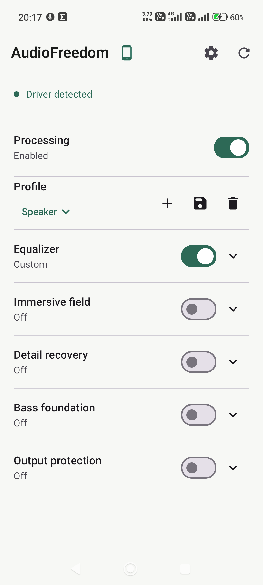
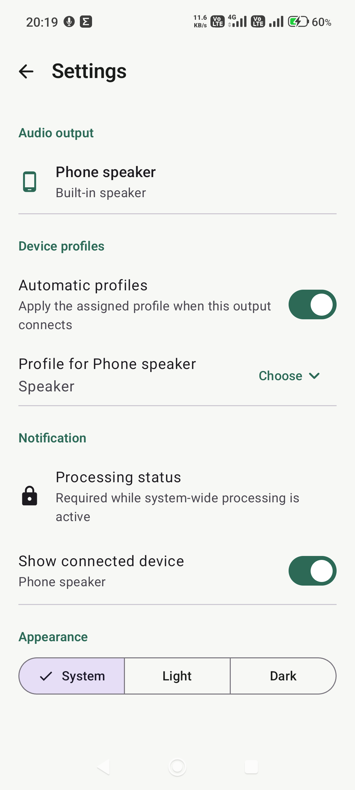
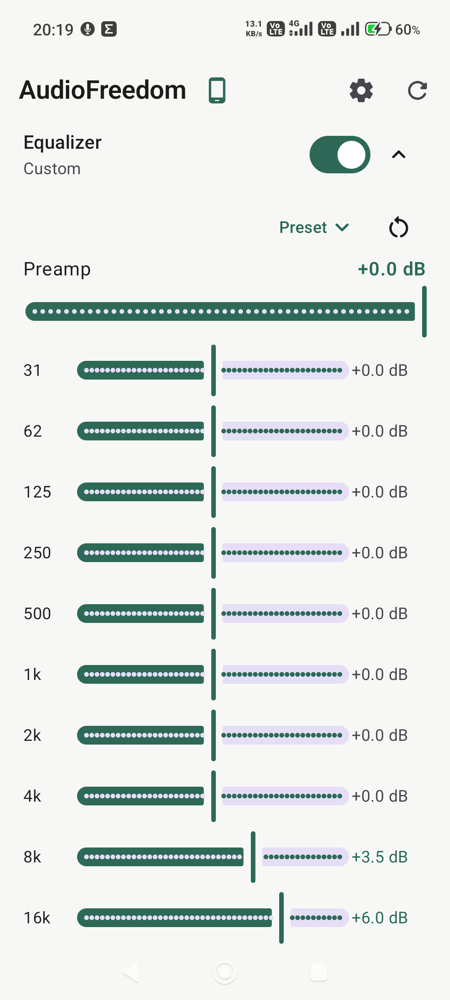
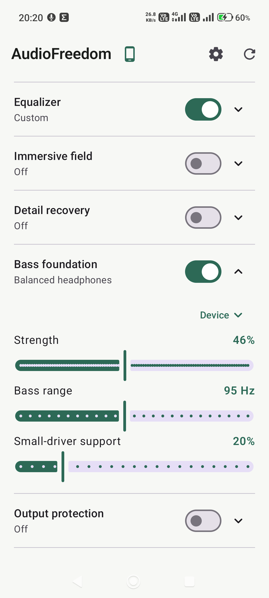
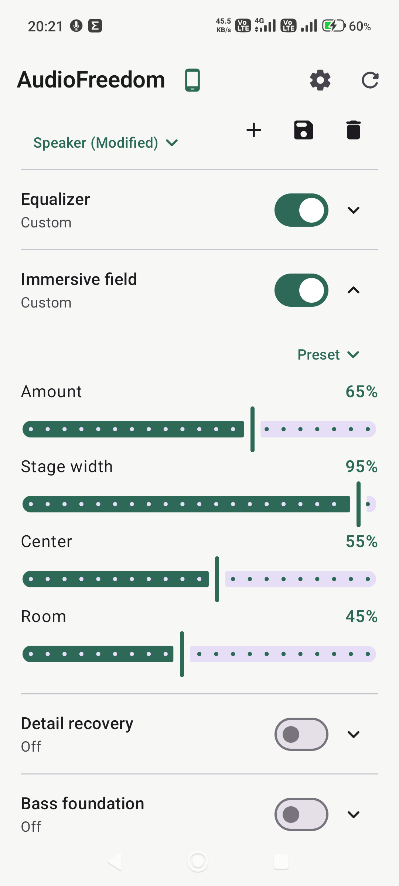

# AudioFreedom

AudioFreedom is an independently implemented, system-wide DSP effect for rooted Android
15 and newer. It combines a platform-independent audio engine, Android AIDL and legacy
effect adapters, a capability-selected root module, and a companion controller app.

AudioFreedom does not contain ViPER4Android code, binaries, branding, presets, or assets.
Its current DSP algorithms, protocol, UUIDs, Android integration, and user interface were
implemented specifically for this project.

AudioFreedom is experimental software for rooted devices. Audio-stack implementations
vary between Android versions, ROMs, and vendors, and offloaded playback may bypass the
software effect chain.

## Screenshots

| Main controls | Settings |
| --- | --- |
|  |  |

| Equalizer | Bass foundation |
| --- | --- |
|  |  |

| Immersive field |
| --- |
|  |

## Features

The latest milestone is **0.9.6-beta**. See the
[release notes](docs/releases/0.9.6-beta.md) for changes since 0.9.5.

- System-wide session-0 processing controlled by a foreground service
- Ten-band constant-Q equalizer with preamp and persistent presets
- Bass Foundation with deep-band lift, adaptive restraint, and small-driver support
- Transient-aware Detail Recovery with linked stereo decisions
- Immersive Field with width, center, room, crossfeed, and early-reflection processing
- Stereo reverb with amount, space, damping, decay, and room presets
- Linked-channel output limiter with configurable ceiling and release
- Optional Volume Leveler with Gentle, Balanced, and Night presets for more consistent playback levels
- Live input, output, and gain-reduction meters
- On-demand playback analysis with RMS, crest factor, stereo correlation, and a ten-band spectrum
- Persistent, output-specific A/B snapshots for comparing DSP settings
- Named profiles with optional automatic assignment by connected output
- Phone speaker, wired, USB, HDMI, and Bluetooth route awareness in the app and notification
- System, light, and dark themes
- Main-page customization: hide unused effects and keep them disabled while retaining their values
- On-demand update checks against the latest public GitHub release
- In-app installation, repair, and verified GitHub updates for the driver module
- Optional on-device assistant with typed commands, offline Whisper push-to-talk,
  bounded DSP changes, private feedback, spoken confirmation, and persistent undo
- English-only assistant commands and readback, with in-app standard-command help
- Atomic combined commands and opt-in conversational tuning under Experimental features,
  with an in-app examples/limits guide and locked-control preservation
- Home-screen voice widget with a compact level-reactive command panel
- Optional offline volume-button voice activation, spoken readback,
  yes/no confirmation, adjustable pause timing, and call suspension
- Short spoken help, cancellation, and volume-button interruption without changing sound
- Automatic bypass outside Android's normal audio mode

## Compatibility

The universal root module selects its backend from the active Android Effects Factory and
process ABI. It has no manufacturer, model, product, or serial-number allowlist.

Validated reference stacks:

- Xiaomi 15 Ultra on Android 16 / HyperOS with a 64-bit Stable AIDL Effects Factory
- Sony Xperia 1 III on LineageOS 23 with a 32-bit classic HIDL Effects Factory

Speaker and Bluetooth processing, persistent control, and live parameter updates have
been confirmed during development. Compatibility still depends on the device's effect
factory, XML configuration, linker rules, SELinux policy, and playback route. Compressed
or Bluetooth hardware offload can bypass AudioFlinger software effects and must be tested
separately.

The installer preserves the device's existing sound-effect libraries, patches copies of
device-owned effect configurations, and mounts those copies systemlessly. It does not use
Xiaomi, Qualcomm, Dolby, or other manufacturer DSP algorithms.

See [Reference devices](docs/REFERENCE_DEVICES.md) and
[Architecture](docs/ARCHITECTURE.md) for integration details and current boundaries.
The supported typed and spoken phrases are listed in the
[Voice command guide](docs/VOICE_COMMANDS.md).
See also [Volume Leveler](docs/VOLUME_LEVELER.md),
[Playback analysis and A/B comparison](docs/PLAYBACK_ANALYSIS_AND_AB.md), and
[Main page functions](docs/MAIN_PAGE_FUNCTIONS.md).

## Repository layout

- `core/`: platform-independent, real-time-safe DSP
- `protocol/`: versioned parameter and status protocol
- `platform/aidl/`: Android Stable AIDL effect backend
- `platform/legacy/`: classic Android effect-library backend
- `platform/controller/`: Android-versioned output-mix controller
- `app/`: companion Android controller
- `assistant-runtime/`: pinned llama.cpp bridge for optional local command interpretation
- `voice-runtime/`: pinned whisper.cpp bridge for optional offline speech recognition
- `module/package-universal/`: universal root-module template
- `tests/`: native DSP and protocol tests
- `tools/`: build, packaging, diagnostics, and device-test scripts
- `docs/`: architecture, reference-device notes, and acceptance tests

Generated builds, device diagnostics, OEM files, and historical private artifacts are
excluded from source control.

## Build the app

Open the repository in Android Studio, or build the debug APK from PowerShell:

```powershell
.\gradlew.bat :app:assembleDebug
```

The app currently targets Android API 36 and has a minimum SDK of 35.

The universal driver ZIP is bundled as an app asset for offline installation. After
rebuilding the driver package, `tools/build-universal-module.ps1` synchronizes that asset
and its SHA-256 metadata before the next APK build.

## Run native tests

```sh
cmake -S . -B out/build -DAUDIOFREEDOM_BUILD_TESTS=ON
cmake --build out/build
ctest --test-dir out/build --output-on-failure
```

An ARM64 Android build of the native tests can be run on one connected device without
root:

```powershell
.\tools\run-native-tests.ps1 -Serial <device-serial>
```

## Root module

The universal package combines AIDL64, legacy64, and legacy32 effect binaries and selects
the compatible backend during installation:

```powershell
.\tools\build-universal-module.ps1
```

The packaging command expects the native backend libraries and probes at the paths shown
by the script parameters. Building the AIDL backend outside an AOSP or LineageOS tree
requires staged Android effect-framework sources; see `tools/stage-aosp.sh`.

Installing the module requires Magisk, KernelSU, or a compatible root-module manager and
a reboot. Disabling or uninstalling the module and rebooting removes its systemless
mounts. Back up important data before testing any root module.

## Support AudioFreedom

If you would like to support this project and its continued development, please
[donate through PayPal](https://www.paypal.com/ncp/payment/LGTB745KAUHRE). There is no
fixed amount; contribute only what you are comfortable with. Donations are optional and
do not affect access to AudioFreedom.

## Licensing

AudioFreedom's original source is publicly visible but is not open-source software at
this stage. All rights are reserved; see [LICENSE](LICENSE). Third-party portions retain
their own licenses and attribution in [THIRD_PARTY_NOTICES.md](THIRD_PARTY_NOTICES.md).

Private `0.8.x` experiments are not part of this repository or its releases. Their
separate personal-use restriction is recorded in
[Historical personal-use ViPER DSP notice](docs/PERSONAL_USE_VIPER_NOTICE.md).
